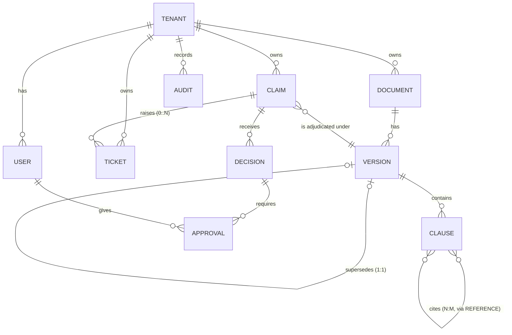

# M1 schema design (draft v1, 2026-11-04)

Status legend: **PROPOSED** = written by the assistant, I have not yet confirmed it.
**DECIDED** = I have read it, understand it, and can defend it in one minute.
Everything starts as PROPOSED. I change a label only after I have thought about it.

How to read this file: each decision has a short "Why" so I learn the reasoning, not just the answer.
Facts I have not verified myself are marked **(verify)**. Check them against current docs
when I write the migrations in M1.

---

## Part 1. Whole domain (rough)

### Diagram

Cardinality in words:

| Arrow | Cardinality | Verb |
|---|---|---|
| tenant -> user | 1:N | has |
| tenant -> document / claim / ticket | 1:N | owns |
| tenant -> audit | 1:N | records |
| document -> version | 1:N | has |
| version -> version | 1:1 | supersedes |
| version -> clause | 1:N | contains |
| clause -> clause (through reference) | N:M | cites |
| claim -> version | N:1 | is adjudicated under (the version in force on the date of loss) |
| claim -> decision | 1:N | receives (a new row each time the outcome changes) |
| decision -> approval | 1:N | requires |
| user -> approval | 1:N | gives |
| claim -> ticket | 1:N | raises |

`AUDIT` has no arrows to other entities on purpose. It points at them loosely with
`entity_type` + `entity_id`, so it keeps working even if another table changes shape or is
later archived.

### What each entity is

| Entity | One line | Tenant scope | Append-only? |
|---|---|---|---|
| tenant | An insurer or firm that uses the system. | is the scope | no |
| user | A person who logs in; belongs to exactly one tenant. | direct | no |
| document | A policy, regulation or claim packet as one logical thing. | direct | no |
| version | One dated edition of a document (effective_from / effective_to). | indirect, via document | immutable once published |
| clause | A node in a version's clause tree with a stable ID. | indirect, via version | immutable per version |
| reference | An edge "clause A refers to clause B". | indirect, via clause | immutable per version |
| claim | One claim packet being adjudicated. | direct | no (status changes) |
| decision | A recommended or final outcome for a claim. | indirect, via claim | yes (new row per change) |
| approval | A human yes/no on a decision. | indirect, via decision | yes |
| ticket | An external or mock ITSM ticket. | direct | no (status syncs) |
| audit | Who did what, when, on which entity. | direct | yes, always |

### Three one-sentence answers

- **Belong to a tenant directly:** user, document, claim, ticket, audit (and refresh_tokens).
- **Belong through another entity:** version (via document), clause and reference (via version), decision (via claim), approval (via decision).
- **Append-only:** audit_log always; approvals and decisions by convention (new row, never edit); versions, clauses and references are immutable once published.

### Rule I will follow (PROPOSED)

**Every tenant-owned table carries its own `tenant_id` column, even when it could be derived
through a join.** Why: filtering without a join is cheaper, harder to get wrong, and Qdrant
and Elasticsearch payloads need `tenant_id` anyway, so the habit is the same everywhere.

---

## Part 2. M1 tables

### Decisions that apply to every table (PROPOSED)

**Primary keys: UUID** generated by the database with `gen_random_uuid()` (built in from
Postgres 13, verify for my Supabase version).
- UUID downside: random v4 values scatter inserts across the index, which is slightly slower and bigger than bigint.
- bigint downside: sequential ids are guessable and leak row counts (an attacker can enumerate ids), and they are harder to merge across systems.
- Exception: `audit_log.id` is bigint identity, because strict insertion order matters there.
- Why UUID for the rest: ids appear in URLs and tokens, so unguessable is worth the small index cost.

**Timestamps: `timestamptz` everywhere.** It stores an absolute instant, so there is no
ambiguity about which time zone wrote a value. Plain `timestamp` silently drops the zone, which
causes bugs when servers or users are in different zones (and I am building for audit trails).

**Emails are normalised** in the app (strip, lowercase) and a CHECK constraint enforces it, so
`A@x.com` and `a@x.com` can never be two users.

**Two Postgres roles:**
`nyaya_migrator` owns the tables and runs Alembic. `nyaya_app` is what the API connects as:
no DDL, and limited rights on audit_log (see below). Why: a bug or an injection in the API
cannot drop or rewrite tables it does not own.

---

### tenants
Purpose: one row per insurer or firm.

| column | type | null? | key / constraint | why it exists |
|---|---|---|---|---|
| id | uuid | no | PK, default gen_random_uuid() | stable identifier |
| slug | text | no | UNIQUE, CHECK (slug = lower(slug)) | human-readable key used at login |
| name | text | no | | display name |
| status | text | no | CHECK IN ('active','suspended'), default 'active' | lock a tenant without deleting data |
| created_at | timestamptz | no | default now() | bookkeeping |

Indexes: UNIQUE (slug) serves the login lookup "which tenant is this?".

---

### users
Purpose: people who log in; each belongs to exactly one tenant.

| column | type | null? | key / constraint | why it exists |
|---|---|---|---|---|
| id | uuid | no | PK | |
| tenant_id | uuid | no | FK -> tenants(id) | tenant scope |
| email | text | no | CHECK (email = lower(email)) | login identity |
| password_hash | text | yes | | Argon2id PHC string; NULL allowed for SSO-only users (M12) |
| display_name | text | yes | | UI |
| is_active | boolean | no | default true | disable without deleting |
| created_at | timestamptz | no | default now() | |
| last_login_at | timestamptz | yes | | support and audit context |

Constraints:
- UNIQUE (tenant_id, email): the same email can exist in two tenants, but only once per tenant.
- UNIQUE (tenant_id, id): looks redundant (id is already unique), but it exists so other tables can use a **composite foreign key** `(tenant_id, user_id)`. See the tenant isolation section.

Indexes: the UNIQUE (tenant_id, email) index also serves the login lookup.

**Email uniqueness: per tenant, not global (PROPOSED).**
- Consequence: login must send the tenant slug together with email and password (or the user logs in on a tenant-specific URL).
- Upside: a consultant can have accounts in two insurers without conflicts; tenants stay fully independent.
- Downside: slightly clumsier login and password reset; a "forgot password" flow must also know the tenant.
- Alternative (global unique): simpler login, but one email can never be in two tenants, and it leaks "this email is already used somewhere".

**Password hashing: Argon2id (PROPOSED).**
OWASP's minimum Argon2id setting is memory 19 MiB (19456 KiB), iterations 2, parallelism 1. I start there or higher and
measure login latency on my machine. The hash is stored as the full self-describing string (it
contains algorithm and parameters), so I can raise the cost later without a schema change.
Library: `argon2-cffi` (check PyPI on the day I add it).
Source: https://cheatsheetseries.owasp.org/cheatsheets/Password_Storage_Cheat_Sheet.html
(re-check the numbers when I implement; guidance changes).

---

### roles and user_roles
Purpose: coarse permissions. **Roles are global and seeded; assignment is per user (PROPOSED).**
Why: custom per-tenant roles are extra machinery M1 does not need. Four fixed roles cover the
whole spec: admin, adjudicator, approver, viewer. A junction table lets a user hold several.

roles:

| column | type | null? | key / constraint | why |
|---|---|---|---|---|
| name | text | no | PK | 'admin', 'adjudicator', 'approver', 'viewer' |
| description | text | yes | | |

user_roles:

| column | type | null? | key / constraint | why |
|---|---|---|---|---|
| tenant_id | uuid | no | | tenant scope |
| user_id | uuid | no | part of PK | |
| role_name | text | no | part of PK, FK -> roles(name) | many roles per user |
| granted_at | timestamptz | no | default now() | |

Constraints: PK (user_id, role_name); FK (tenant_id, user_id) -> users(tenant_id, id).
Indexes: (tenant_id, role_name) for "who are the approvers in this tenant?".

---

### refresh_tokens
Purpose: refresh-token rotation with reuse detection.

**Decision (PROPOSED): Postgres table is the source of truth; Redis only caches.**

Reasons:
- Reuse detection needs the whole chain ("family") of tokens from one login. If a used token shows up again, I revoke the family. A `family_id` column makes that one query.
- "Revoke all sessions for this user" is a query by user_id. In Redis I would need a secondary index I build myself.
- Sessions survive a Redis restart (Redis may be configured without persistence, and a restart would log everyone out).
- Expiry cleanup is a scheduled `DELETE WHERE expires_at < now() - interval` job (Celery beat).

What I give up:
- Every refresh is a database write (slower than Redis, but refreshes are rare compared to API calls).
- A cleanup job I must write and monitor.
- Note: the brief (section 10 and the Redis row) says tokens live in Redis. This is a deliberate change, so it needs **ADR 002**.

| column | type | null? | key / constraint | why |
|---|---|---|---|---|
| id | uuid | no | PK | |
| tenant_id | uuid | no | | tenant scope |
| user_id | uuid | no | FK (tenant_id, user_id) -> users | owner |
| family_id | uuid | no | | one login chain; revoked together on reuse |
| token_hash | bytea | no | UNIQUE | SHA-256 of the token; the raw token is never stored |
| fingerprint_hash | bytea | no | | hash of the fingerprint cookie bound to this token |
| issued_at | timestamptz | no | default now() | |
| expires_at | timestamptz | no | | hard expiry |
| used_at | timestamptz | yes | | set when rotated; presenting a used token = reuse = revoke family |
| replaced_by | uuid | yes | | next token in the chain |
| revoked_at | timestamptz | yes | | |
| revoked_reason | text | yes | | 'logout', 'reuse_detected', 'admin' |

Indexes:
- UNIQUE (token_hash): the lookup on every refresh.
- (family_id): revoke a whole family.
- partial (user_id) WHERE revoked_at IS NULL: list a user's active sessions.
- (expires_at): the cleanup job.

Why store a hash: if the table leaks, the attacker gets hashes, not usable tokens. SHA-256 is fine here
(unlike passwords) because the tokens are long random values, not guessable by brute force.

---

### audit_log
Purpose: system of record for "who approved what". It must stay complete even if LangSmith is off.

| column | type | null? | key / constraint | why |
|---|---|---|---|---|
| id | bigint | no | PK, GENERATED ALWAYS AS IDENTITY | strict ordering |
| occurred_at | timestamptz | no | default now() | **when** |
| tenant_id | uuid | no | FK -> tenants(id) | scope |
| actor_type | text | no | CHECK IN ('user','system','agent') | **who** (kind) |
| actor_user_id | uuid | yes | | **who** (a person); NULL for system and agent |
| action | text | no | | **what**, e.g. 'decision.approved', 'ticket.created' |
| entity_type | text | no | | **on which entity** (kind) |
| entity_id | text | no | | on which entity (id; text so any id type fits) |
| request_id | text | yes | | **from which request** (ties to API logs) |
| trace_id | text | yes | | LangSmith run id: ties "who approved" to "what the model did" |
| ip | inet | yes | | |
| before | jsonb | yes | | state before the change |
| after | jsonb | yes | | state after the change |
| metadata | jsonb | no | default '{}' | anything else |

Indexes:
- (tenant_id, occurred_at DESC): "latest activity in my tenant".
- (tenant_id, entity_type, entity_id): "full history of this decision".

**How to make it append-only (PROPOSED): two layers.**
1. **Permissions:** `REVOKE UPDATE, DELETE, TRUNCATE ON audit_log FROM nyaya_app;` so the API can only INSERT and SELECT.
2. **Trigger:** a BEFORE UPDATE OR DELETE trigger that raises an exception, so even a mistake by the table owner is blocked. TRUNCATE needs its own statement-level trigger.

Why both: permissions stop the app; the trigger stops accidents by anyone with more rights. Neither stops a
superuser who deliberately drops the trigger, which is why a hash chain (each row stores the hash of the
previous row) would be the next step. I defer it (see open question 4). Verify exact syntax in the Postgres docs.

---

### Tenant isolation: how tenant_id is enforced (PROPOSED)
(Before marking DECIDED, rewrite this paragraph in my own words.)

Brief section 4 rules out Supabase RLS, so isolation lives in my code and my schema, in four layers:

1. **Repository layer.** Every repository class takes a `TenantContext` in its constructor, and no repository method exists without one. The context is built from the verified token, never from the request body or query string, so a client cannot choose its own tenant.
2. **One shared query helper** adds the `tenant_id` filter to every select, update and delete. One place to audit instead of fifty.
3. **Composite foreign keys.** A child row references `(tenant_id, parent_id)` in the parent, so the database itself refuses a row in tenant A that points at tenant B's parent. This is why users has UNIQUE (tenant_id, id).
4. **Tests that try to break it.** Two tenants with the same email both work. Tenant A's token asking for tenant B's row by id gets "not found" (a 404, not 403, so existence is not leaked). The same style of test is repeated later for Qdrant and Elasticsearch filters.

**M1 is done only when the cross-tenant test passes.**

What I give up by not using RLS: the database cannot catch a query I forgot to filter. The shared
helper and the tests are the substitute, so the tests are not optional.

---

## Part 3. MongoDB (small version)

Rules for every collection: documents carry `tenant_id` (except eval runs). A TTL index must be a
**single-field** index on a **BSON Date** field. If the field is missing or not a date, the document
never expires. The TTL monitor runs about every 60 seconds, so deletion is approximate, not exact.
Source: https://www.mongodb.com/docs/current/core/index-ttl/

Why 512 MB matters: Atlas M0 caps storage at 512 MB, so unbounded logs (especially full prompts and
tool outputs) can fill it and break writes. Short retention plus TTL from day one keeps it safe.

| Collection | Key fields | TTL field | Retention (PROPOSED) | Other indexes |
|---|---|---|---|---|
| conversations | tenant_id, conversation_id, case_id, user_id, turn_index, role, content | created_at | 90 days | (tenant_id, conversation_id, turn_index) |
| tool_call_logs | tenant_id, case_id, run_id, tool_name, args (redacted), status, latency_ms, error | created_at | 30 days | (tenant_id, case_id, created_at) |
| ingestion_logs | tenant_id, batch_id, document_job_id, stage, status, duration_ms, error | created_at | 60 days | (tenant_id, document_job_id, created_at) |
| eval_runs | run_id, eval_set_version, prompt_versions, metrics, per_case_results | none | keep (small, and it is interview evidence) | unique (run_id) |
| llm_usage | tenant_id, case_id, run_id, provider, model, input_tokens, output_tokens, cost_micro_usd, cache_hit, latency_ms | created_at | 90 days | (tenant_id, created_at) |
| mock_ticket_payloads | tenant_id, ticket_id, provider, payload | created_at | 30 days | (tenant_id, ticket_id) |

Design notes:
- `conversations` stores one document per turn, not one growing array, so a long chat cannot hit the 16 MB document limit.
- The TTL index and the lookup index are separate indexes, because a TTL index must be single-field.
- Money is stored as integer micro-dollars (`cost_micro_usd`), never floats, to avoid rounding drift.
- `created_at` must be written as a real Date, not an ISO string, or TTL silently does nothing.

---

## Open questions I must answer

(Proposed answers; I confirm or change each.)

1. **UUID v4 or v7?** Proposed: start with v4 (`gen_random_uuid()`, built in). v7 is time-ordered and reduces index scatter, but I must check whether my Postgres version has it built in (verify) before relying on it. Not worth an extension in M1.
2. **Is per-tenant email uniqueness worth the login change?** Proposed: yes. It matches the multi-tenant model; the cost is that login sends a tenant slug.
3. **Do refresh tokens live in Postgres?** Proposed: yes, with Redis as optional cache. Write ADR 002 with the trade-offs above.
4. **Audit hash chain now or later?** Proposed: later. Permissions plus trigger is enough for M1; the chain is a stretch that I can add without changing the columns much (one extra `prev_hash` column).

### The one thing I disagree with most
(Fill this in after reading. Even "nothing yet, because ..." is a valid answer if I can say why.)

### My machine (for step 4 and open decision 5)
- RAM: ______
- `docker --version`: ______
- `docker compose version`: ______